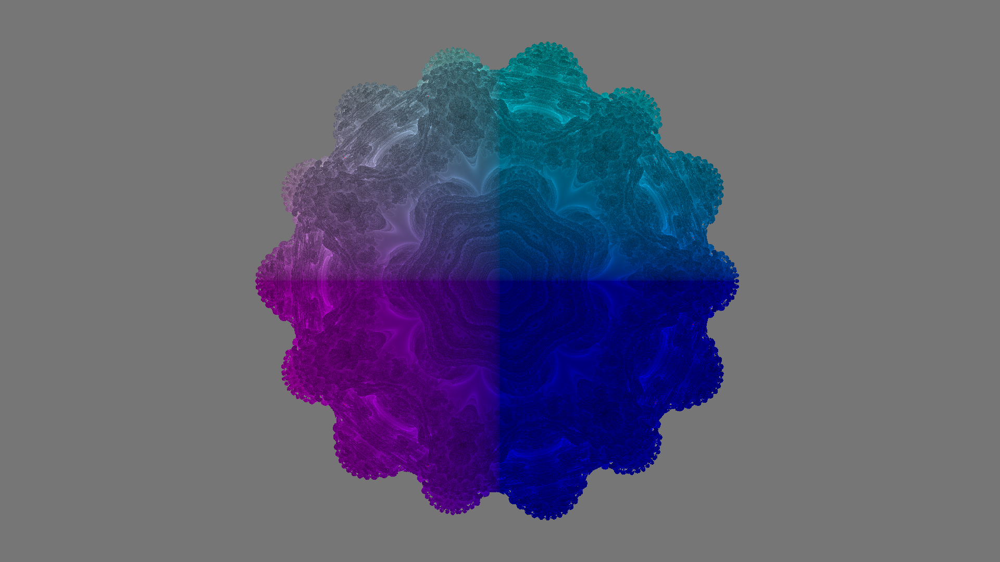
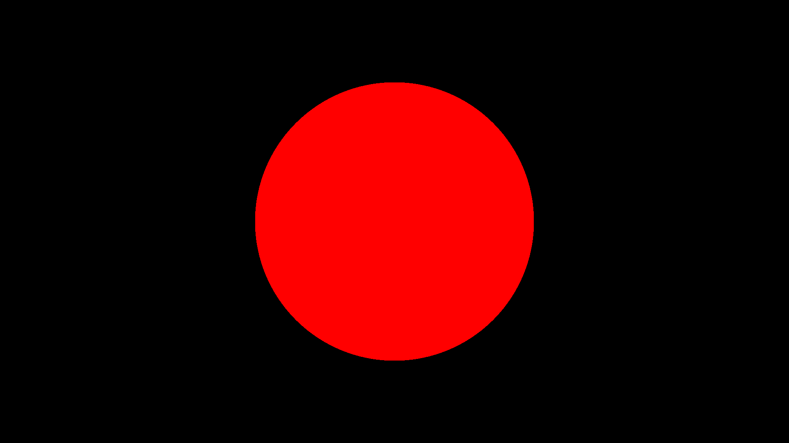

# Pragma Engine

A CPU ray marcher I built for CPSC 3220 (Operating Systems) at Clemson. It renders signed distance field (SDF) scenes, including a Mandelbulb, and splits each frame into tiles that worker threads render in parallel. The main goal was to compare two ways of handing out that work, static and dynamic scheduling, and see how each scales with thread count.

## Renders

### Mandelbulb



[Watch Mandelbulb Animation](https://youtu.be/9kWrbisHZGk)

### Fractal Tower


[Watch Fractal Tower Animation](https://youtu.be/TRJZj_DH--o)

Both fractals are shaded by how many steps the ray took, not by real lighting.

### Sphere



A plain SDF sphere with no surface lighting. I used it to check that the marcher and camera worked before adding the fractals.

## What it does

- Ray marches procedural scenes using signed distance functions
- Includes a Mandelbulb, a Fractal Tower, and a sphere
- Splits each frame into tiles that can be rendered independently
- Runs on a configurable number of worker threads (C++ standard threads)
- Static scheduling: each worker gets a fixed, strided set of tiles
- Dynamic scheduling: workers claim the next tile from a shared atomic counter
- Lets you set resolution, frame count, marching parameters, thread count, and tile grid from the command line
- Renders multi-frame animations and writes each frame as an EXR
- Logs how long the scheduler and the frame output take

## Shading

There's no physically based lighting here. Color comes from the ray-marching step count and, in some scenes, the hit position.

- **Mandelbulb:** step count and hit position drive the color.
- **Fractal Tower:** grayscale based on step count.
- **Sphere:** flat red, no lighting.
- **Misses:** each scene picks its own background color.
- **Out of steps:** rays that use up the maximum steps without hitting anything show up red.

## Parallel rendering

Each frame is cut into a grid of tiles, and the worker threads render them.

**Static scheduling.** Each worker takes a strided sequence of tile indices, decided up front. It's simple and has almost no overhead, but if one worker's tiles are more expensive than another's, the cheap workers finish early and wait.

**Dynamic scheduling.** Workers grab the next unclaimed tile from an atomic counter and keep going until none are left. Workers that finish early just take more tiles.

Both schedulers use the same marcher and the same scenes, so the comparison is fair.

## Benchmarks

Times are wall-clock for the full render loop in a Release build, and they include the per-frame EXR write. Each number is the mean of 3 runs. Speedup is measured against 1 thread, and efficiency is speedup divided by thread count.

### Desktop: AMD Ryzen 7 9800X3D

| Threads | Schedule | Mean (s) | Speedup | Efficiency |
|---:|---|---:|---:|---:|
| 1 | Static | 171.33 | 1.00x | 100% |
| 4 | Static | 49.70 | 3.45x | 86% |
| 4 | Dynamic | 48.60 | 3.53x | 88% |
| 8 | Static | 34.43 | 4.98x | 62% |
| 8 | Dynamic | 29.30 | 5.85x | 73% |

### Laptop: Intel Core i7-12800H (hybrid, 20 hardware threads)

| Threads | Schedule | Mean (s) | Speedup | Efficiency |
|---:|---|---:|---:|---:|
| 1 | Static | 349.59 | 1.00x | 100% |
| 4 | Static | 101.76 | 3.44x | 86% |
| 4 | Dynamic | 99.18 | 3.52x | 88% |
| 8 | Static | 76.56 | 4.57x | 57% |
| 8 | Dynamic | 64.57 | 5.41x | 68% |

### What I saw

- Every 4- and 8-thread run passes 3x.
- Dynamic won on both machines, and the gap got bigger from 4 to 8 threads. Mandelbulb tiles vary a lot in cost, so letting early finishers pick up more work pays off.
- Efficiency drops at 8 threads. The EXR write for each frame is serial, and shared resources like memory bandwidth and clock speed probably add to it. On the laptop, the mix of fast and slow cores likely matters too. I didn't isolate any of these.
- Setting CPU affinity might help on the laptop. I haven't tried it.

My first test, a single run on Clemson's Ada4 machines, gave 195.443 s on 1 thread vs 80.738 s on 3 threads (both static), about a 2.42x speedup.

## Architecture

```text
Main
└── Engine
    ├── SceneManager
    │   └── Scene
    │       ├── SDF Evaluation
    │       ├── Shading
    │       └── Camera
    │
    └── Renderer
        ├── Tile Scheduler
        │   ├── Static Scheduling
        │   └── Dynamic Scheduling
        ├── Worker Threads
        ├── Ray Marcher
        └── Frame Buffer
            └── EXR Output
```

| Component | What it does |
|---|---|
| `Engine` | Runs the application and drives frame rendering. |
| `SceneManager` | Holds the active scene. |
| `Scene` | Defines the SDF, the shading, and the camera. |
| `Renderer` | Builds tiles, hands out work, and owns the frame buffer. All the threading code is in `src/renderer/renderer.cpp`. |
| `RayMarcher` | Marches rays and checks them against the SDF. |
| `Math` | My own small linear algebra helpers. |
| `Logging` | Records scheduler and frame-output timings. |

## Built with

- C++20
- CMake
- C++ standard library threads
- TinyEXR for EXR output

## Tested on

- Windows 11, Visual Studio 2022
- Windows 11 with WSL (where the benchmarks were run)
- Linux, Clemson Ada4 (early testing)

## Building and running

### Linux / WSL

From the project root:

```bash
mkdir build
cd build
cmake ..
make
```

Then run it from the build directory:

```bash
./RayMarchingFractals
```

On single-config generators like Make, CMake defaults to a Release build.

### Windows

Open the folder in Visual Studio 2022 and build the Release configuration. CMake handles the rest.

## Command-line options

Everything is optional. Defaults are below.

| Argument | Default | What it does |
|---|---|---|
| `-w` | `1920` | Output image width |
| `-h` | `1080` | Output image height |
| `-fName` | `output` | Output folder and filename prefix |
| `-scene` | `MandelBulbScene` | Which scene to render |
| `-frames` | `24` | Number of frames |
| `-steps` | `2500` | Maximum marching steps |
| `-near` | `0.01` | Near marching distance |
| `-far` | `100` | Maximum marching distance |
| `-epsilon` | `0.0001` | Surface-hit tolerance |
| `-threads` | `1` | Number of worker threads |
| `-tres` | `16` | Tile grid resolution per dimension |
| `-dynamic` | off | Use dynamic tile scheduling |
| `-logging` | off | Print timing logs |

`-tres 16` makes a 16 by 16 grid, so up to 256 tiles.

### Examples

Static scheduling with 3 threads:

```bash
./RayMarchingFractals -threads 3
```

Dynamic scheduling with 3 threads:

```bash
./RayMarchingFractals -threads 3 -dynamic
```

The 8-thread benchmark configurations:

```bash
./RayMarchingFractals -threads 8 -logging
./RayMarchingFractals -threads 8 -dynamic -logging
```

Pick a scene:

```bash
./RayMarchingFractals -scene SphereScene
./RayMarchingFractals -scene MandelBulbScene
./RayMarchingFractals -scene FractalTowerScene
```

Change the resolution and frame count:

```bash
./RayMarchingFractals -w 1920 -h 1080 -frames 24
```

## Output

Frames are written as numbered EXR files:

```text
outputs/
└── <name>/
    ├── <name>.0000.exr
    ├── <name>.0001.exr
    └── ...
```

`outputs/exr_to_mp4.py` turns a sequence of EXR frames into a video.

## Project structure

```text
Pragma-Engine/
├── main.cpp
├── CMakeLists.txt
├── CMakePresets.json
├── src/
│   ├── engine/
│   ├── logging/
│   ├── marcher/
│   ├── math/
│   ├── renderer/
│   ├── scene/
│   └── settings.h
├── renders/
│   ├── MandelBulbColor.png
│   ├── MandelBulb.mp4
│   ├── FractalTowerColor.png
│   ├── FractalTower.mp4
│   └── sphere.png
└── outputs/
    └── exr_to_mp4.py
```

## Author

**Dylan Kauffman**

GitHub: [Ljuvay](https://github.com/Ljuvay)
